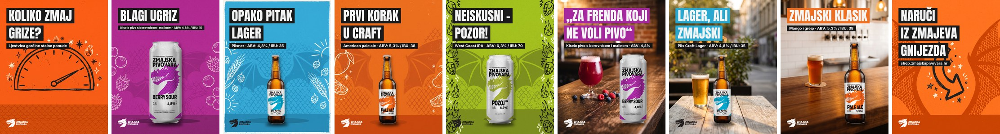

# Brand Post Recipe

A repeatable AI recipe that turns an Instagram brand into **three finished, ready-to-publish posts**:
images (1080×1350), captions with hashtags, format, goal and rationale for each post.

Demo brand: [Zmajska pivovara](https://zmajskapivovara.hr/), the first Croatian craft brewery.
Code and docs are in English; the analysis, the posts and the web UI are in Croatian.



Project write-up (Croatian, 2 pages): [docs/recipe.pdf](docs/recipe.pdf)

## How it works

The recipe runs in six separate phases. Each phase reads the previous phase's JSON and saves its own in
`runs/<run_id>/`, so a run can be stopped, inspected, edited by a human and resumed or re-run from any phase.

| Phase | AI | What happens | Output |
|---|---|---|---|
| `brief` | – | Validates the inputs, reads past captions, fetches the official website and webshop pages | `01_brief.json` |
| `analysis` | Claude | Tone of voice, writing rules, colors (hex), photo and graphic style, products; **verified facts with sources** kept apart from assumptions | `02_analysis.json` |
| `plan` | Claude | Three posts with different goals: format, concept, rationale, slide texts, scene prompts, captions, hashtags. A human reviews and edits it here | `03_plan.json` |
| `create` | Gemini | The image model generates **only the background scene**; the real product photo, the real logo and the headline are composited on top with Pillow, so labels are never distorted | `images/`, `04_create.json` |
| `review` | Claude | Visual and copy QA per slide (product accuracy, natural look, brand fit, legibility, score 1–10). Failed slides are regenerated with a concrete scene fix, the best attempt is kept | `05_review.json` |
| `deliver` | – | One folder per post (slides + `caption.txt`), a summary with goals, rationale and cost, and a ZIP with all phase outputs | `final/` |

### Design decisions

- **Never generate the product or the logo.** Image models garble labels and lettering, so they only paint the scene.
  The cut-out packshot is placed on the surface with a contact shadow and brightness matching; its baked-in white floor
  shadow is turned into a transparent one.
- **Structured outputs.** Every Claude call returns a validated Pydantic object (`output_format`), streamed, with
  explicit handling of refusals and cut-off answers. No free-text parsing.
- **Facts only from sources.** The analysis may list as a fact only what is on the website or a label; QA checks the
  captions against those facts and the website text. No invented prices, discounts or events; responsible alcohol rules.
- **The human has the last word.** A caption edited by a human is never rewritten by QA, only a suggestion is shown.
  The AI's original plan is kept as `03_plan.ai.json`. Text and layout edits re-composite the slides from the saved
  scenes, with no new images and no cost.
- **Cost control.** Every call records its cost (tokens, images). Hard limits on images per run and review retries.
  The balance from each provider's console can be entered in the UI; a phase does not start if the remaining
  credit cannot pay for it.

## Stack

- **Core:** Python 3.14, [Anthropic SDK](https://github.com/anthropics/anthropic-sdk-python) (`claude-opus-5-5`),
  [Google GenAI SDK](https://github.com/googleapis/python-genai) (`gemini-nano-banana-2.1`), Pillow, httpx + BeautifulSoup
- **API:** FastAPI: runs phases in the background, plan editing, file serving
- **UI:** Vue 3, Vue Router, Vite, Tailwind CSS 4
- **Everything runs in Docker**; dependencies are locked with uv (`uv.lock`) and npm (`package-lock.json`)

## Running

Requirements: Docker with Compose, an [Anthropic API key](https://console.anthropic.com) and a
[Gemini API key](https://aistudio.google.com/api-keys) with billing enabled.

```bash
cp .env.example .env          # add ANTHROPIC_API_KEY and GEMINI_API_KEY
docker compose build api
docker compose up -d          # UI on http://localhost:5175, API docs on http://localhost:8001/docs
```

In the UI: **Pokreni demo** starts a run from the prepared Zmajska brief; **Novi brif** is a form for any other brand
(website, products with cut-out photos, logo, screenshots and captions of recent posts).

Command line:

```bash
docker compose run --rm cli new inputs/zmajska/brief.yaml --stop-after plan   # stop for a human review of the plan
docker compose run --rm cli resume <run_id>                                   # continue from the first unfinished phase
docker compose run --rm cli resume <run_id> --from plan --note "More humor"   # re-run a phase with feedback
docker compose run --rm cli recompose <run_id>                                # re-composite slides from saved scenes (free)
docker compose run --rm cli status <run_id>
docker compose run --rm cli list
docker compose run --rm cli budget [--set claude=2.26 gemini=4.50]            # credit left (estimate)
```

Settings (`.env`): models, image size, `MAX_IMAGES_PER_RUN`, `MAX_REVIEW_RETRIES`, `IMAGE_WORKERS`.

A full run takes about 11 minutes and cost $3.35 for the final demo run (Claude $2.18, Gemini $1.18 for 14 images
including 5 regenerated ones).

## Tests

```bash
docker compose --profile test run --rm pytest           # 31 tests, fake AI clients, no API cost
docker compose run --rm --no-deps frontend npm test     # 12 Vitest tests
```

CI (GitHub Actions) runs both on every push to `testing` and `main`; changes reach `main` through pull requests.

## Project layout

```
recipe/            core: phases (pipeline.py), Claude and Gemini clients, compositing, web reader,
                   run storage, credit tracking, prompts/, fonts/
api/main.py        FastAPI app
cli.py             command line
frontend/          Vue app (one panel per phase)
inputs/zmajska/    demo brief, logo and product photos
tests/             pytest suite with fake AI clients
docs/              write-up (PDF) and images
```

## Demo materials

The logo and product photos belong to Zmajska pivovara and are included only to make the demo runnable.
Screenshots and captions of the brand's Instagram posts are not published in this repository (they were collected
by hand; Instagram is not scraped). The recipe works without them, they are optional context for the analysis.
All generated images carry Google's invisible SynthID watermark.
